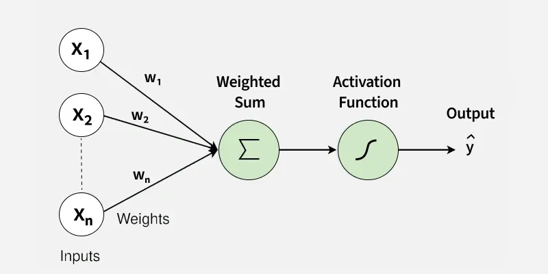

### **Perceptron – Short Note**

A **Perceptron** is the simplest type of Artificial Neural Network (ANN), mainly used for binary classification. It is a supervised machine learning algorithm that mimics the basic working of a biological neuron.

**Working:**

1. Takes input values (\\(x_1,x_2,\ldots,x_n\\)).
2. Multiplies each input by its corresponding weight (\\(w_1,w_2,\ldots,w_n\\)).
3. Adds all weighted inputs and bias (\\(b\\)).
4. Passes the result through an activation function.
5. Produces the final output (0 or 1).

**Mathematical Model:**

\\[ z = \sum\_{i=1}^{n}w_ix_i+b \\]

**Activation Function:**
For eg Step :-
\\[ y = \begin{cases} 1 & z\geq 0\\\ 0 & z<0 \end{cases} \\]
More :-
Sigmoid , Tanh , ReLU , Softmax

**Components:**

- **Inputs:** Features given to the model.
- **Weights:** Importance assigned to each input.
- **Bias:** Helps adjust the decision boundary.
- **Summation:** Calculates weighted sum.
- **Activation Function:** Decides the final output.

